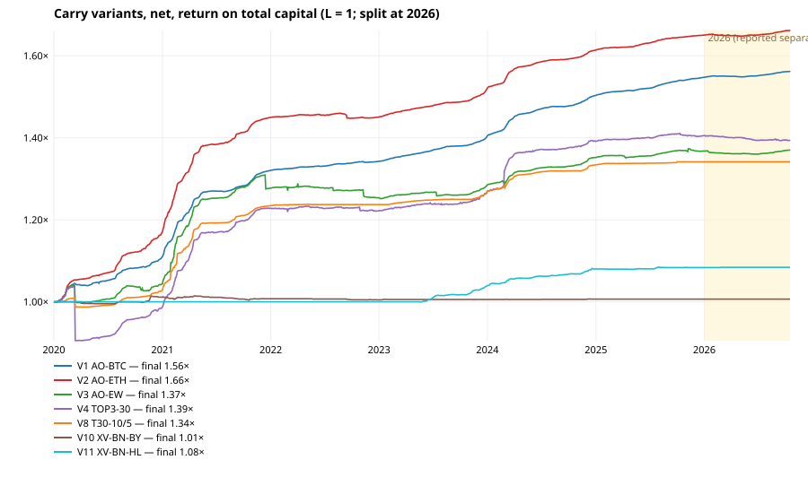
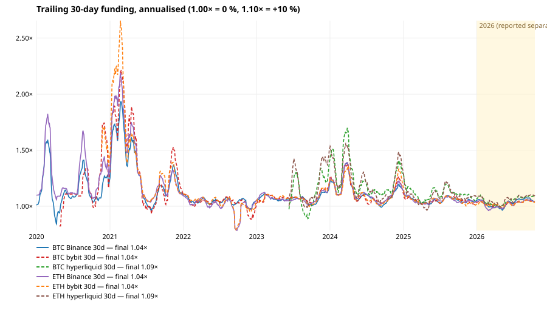

# Delta-neutral funding carry (long spot + short perp): result

**Bottom line.** Delta-neutral carry was a real but small, shrinking premium:
- **2020–2025:** always-on BTC or ETH carry (long spot + short Binance perp, 1x short margin) returned
  **+7.5 % / +8.7 % a year on total capital** after every cost. Max drawdown was below 1 %. All six
  development years were positive. 2021 alone contributed +19 % / +24 %.
- **2026 (Jan 1 – Oct 17):** the same two variants made **+0.85 % / +0.60 %**, about +1 % a year,
  because Binance BTC funding fell to +2.9 % annualised. That is below what idle USDT earns elsewhere.
- **The variants that try to be clever** (top-N by trailing funding, threshold entry with hysteresis,
  cross-venue spreads) did not beat plain always-on BTC/ETH in development, and none was positive in 2026.
- **Biggest risk: the short leg, not the funding.** Every one of the 20 coins had a 30-day pump larger
  than 100 % at some point. An un-topped-up 1x short would have been liquidated on every coin. Even with
  daily re-margining, 2x ETH and 3x BTC/ETH shorts were liquidated, mostly on last-price wicks.

Pre-registration: `docs/CARRY_PREREG.md`, committed before any carry P&L was computed. There are no
deviations from it; the model caveats are in §6. Research only: nothing places orders.

Reproduce:

```
python scripts/carry_data.py      # caches history in ~/.hermes/cache/scratch/carry
python scripts/carry_analysis.py  # descriptive stats + 11 variants + sensitivity → docs/evidence/carry/summary.json
python scripts/carry_report.py    # tables.md + SVG charts
```

The simulator is `carry_model.py`; its tests are in `tests/test_carry_model.py`.

## 1. Data

- **Universe:** the 20-coin main universe of the strategy research.
- **Binance funding:** every `/fapi/v1/fundingRate` print since 2020 (BTC: 7,785 prints).
- **Bybit funding:** `/v5/market/funding/history`, available from 2020-03 (BTC) to 2023 (new coins).
- **Hyperliquid funding:** hourly `fundingHistory` since 2023-05-12. 1000PEPE is `kPEPE`; ZEC and
  DASH have short HL histories.
- **Spot bars:** Binance spot `/api/v3/klines` 1d. 1000PEPE uses PEPEUSDT × 1000. PEPE, SUI and WLD
  spot start in 2023.
- **Perp bars:** the research cache (Binance USDT-M 1h aggregated to UTC days). Bybit linear and HL 1d
  candles are used for the cross-venue pairs (BTC/ETH).

Hand check against the raw venue endpoint, fetched fresh for this report rather than from the cache.
BTC, ETH and SOL, calendar 2024, from `/fapi/v1/fundingRate`:

| coin | prints | Σ rates | annualised (Σ × 365 / 365.7 covered days) | table value | negative prints |
|---|---|---|---|---|---|
| BTC | 1,098 | 0.11956883 | 11.935 % | 11.935 % | 8.4 % |
| ETH | 1,098 | 0.12996919 | 12.973 % | 12.973 % | 4.2 % |
| SOL | 1,098 | 0.13657023 | 13.632 % | 13.632 % | 10.3 % |

All three match exactly. With a 366-day calendar year the figures would be 11.92 / 12.96 / 13.62 %.
The convention used throughout is the span from the first to the last print in the window.

## 2. Costs and execution (as pre-registered)

- **Fees:** spot taker 0.10 % (sensitivity: 0.075 % with BNB); perp taker 0.05 % Binance,
  0.055 % Bybit, 0.045 % HL; 0.01 % slippage per leg and side. A full round trip on both legs costs
  0.34 % of notional.
- **Timing:** decisions at the UTC close; fills at the next open on both legs.
- **Hedge:** 1:1 in units. A short-leg equity outside [0.5, 1.5] × its target is re-split at the
  next open, with fees on the traded |Δq| of both legs.
- **Funding and basis:** funding is received on the short leg. Basis is marked at both legs'
  closes, so the spread change between entry and exit is in the P&L.
- **Liquidation:** if the day's perp HIGH takes the short leg below maintenance (0.5 % BTC/ETH,
  1 % others), the leg is lost.
- **Return base:** total capital (spot + margin). At 1x, half the capital is the spot notional and
  half the margin. Cash earns nothing.

## 3. Results

Charts:
- [variants.svg](evidence/carry/variants.svg): equity of 7 variants, with 2026 shaded.
- [funding_30d.svg](evidence/carry/funding_30d.svg): trailing 30-day annualised funding for BTC
  and ETH on Binance (solid), Bybit and Hyperliquid (dashed).





### Binance gross funding yield (annualised, % of notional; short perp receives)

| coin | 2020 | 2021 | 2022 | 2023 | 2024 | 2025 | 2026 | dev ann | dev neg prints | dev neg days | dev worst cum. DD | 2026 ann | 2026 neg prints |
|---|---|---|---|---|---|---|---|---|---|---|---|---|---|
| BTC | +17.2% | +30.6% | +4.2% | +7.9% | +11.9% | +5.1% | +2.9% | +12.8% | 13% | 11% | 1.52% (2020-03-12→2020-04-23) | +2.9% | 26% |
| ETH | +27.4% | +37.6% | +0.8% | +8.3% | +13.0% | +4.9% | +2.0% | +15.3% | 12% | 10% | 1.79% (2022-08-23→2022-09-25) | +2.0% | 30% |
| SOL | -12.6% | +28.6% | -38.0% | +1.3% | +13.6% | +0.4% | -0.9% | +0.4% | 26% | 26% | 43.40% (2022-04-23→2023-01-13) | -0.9% | 47% |
| ZEC | +29.3% | +37.2% | +5.1% | +10.9% | +14.6% | -17.6% | -2.3% | +13.0% | 11% | 11% | 19.35% (2025-03-25→2025-12-13) | -2.4% | 37% |
| XRP | +24.6% | +48.2% | +0.0% | +8.2% | +14.2% | +3.5% | -0.1% | +16.4% | 17% | 15% | 2.49% (2022-05-09→2023-01-05) | -0.1% | 48% |
| DOGE | +9.4% | +38.5% | +3.5% | +10.0% | +14.0% | +4.3% | +3.1% | +13.7% | 16% | 14% | 2.55% (2021-01-28→2021-02-02) | +3.1% | 31% |
| BNB | +2.5% | +21.7% | -12.6% | -8.4% | -3.3% | -2.1% | +2.8% | -0.4% | 27% | 37% | 30.86% (2021-05-19→2025-06-24) | +2.8% | 1% |
| 1000PEPE | — | — | — | +10.2% | +20.1% | +3.8% | -1.3% | +11.5% | 19% | 18% | 1.56% (2023-05-06→2023-05-19) | -1.2% | 39% |
| SUI | — | — | — | +4.3% | +10.3% | +3.4% | +3.0% | +6.2% | 27% | 26% | 1.75% (2023-05-03→2023-09-15) | +3.0% | 31% |
| NEAR | +12.2% | +37.7% | -4.2% | +6.9% | +14.0% | +2.1% | +4.0% | +11.3% | 20% | 21% | 5.86% (2022-04-26→2022-08-15) | +4.0% | 27% |
| ADA | +26.3% | +40.0% | -1.0% | +7.2% | +14.0% | +4.1% | +1.5% | +15.0% | 17% | 17% | 1.88% (2022-01-20→2022-10-25) | +1.5% | 39% |
| LINK | +11.5% | +43.1% | +5.9% | +10.2% | +13.3% | +5.2% | +4.6% | +14.9% | 12% | 11% | 5.65% (2020-02-25→2020-04-22) | +4.6% | 21% |
| WLD | — | — | — | +2.0% | +13.1% | +3.3% | -5.9% | +7.1% | 25% | 25% | 3.10% (2023-07-25→2023-10-23) | -5.9% | 45% |
| AVAX | -12.7% | +31.1% | -5.2% | +7.5% | +10.5% | +0.1% | +1.3% | +7.7% | 27% | 29% | 6.78% (2020-09-23→2021-02-08) | +1.3% | 36% |
| UNI | +12.1% | +42.0% | +6.5% | +9.9% | +13.5% | +6.3% | +4.3% | +15.4% | 9% | 8% | 2.44% (2020-09-18→2020-09-25) | +4.3% | 24% |
| FIL | -162.3% | +39.3% | +2.2% | +11.5% | +15.6% | +2.5% | +0.7% | +7.1% | 16% | 15% | 33.95% (2020-10-16→2020-12-31) | +0.7% | 36% |
| BCH | +22.5% | +33.8% | -6.0% | -9.0% | -1.1% | -2.6% | -2.9% | +6.3% | 35% | 37% | 21.34% (2022-06-09→2025-12-31) | -2.8% | 49% |
| LTC | +25.5% | +40.1% | +2.9% | +9.3% | +14.4% | +5.6% | +3.1% | +16.3% | 11% | 10% | 0.81% (2022-01-30→2022-03-12) | +3.1% | 31% |
| AAVE | +21.5% | +47.8% | +4.7% | +9.7% | +11.0% | +5.3% | +2.7% | +15.9% | 13% | 12% | 1.12% (2020-11-04→2020-11-11) | +2.7% | 28% |
| DASH | +19.0% | +35.4% | +6.1% | +10.0% | +13.9% | -14.9% | -9.1% | +11.5% | 9% | 8% | 21.48% (2025-10-11→2025-12-17) | -9.1% | 32% |

### Cross-venue gross yield (dev = 2020–2025 where available; HL from its launch)

| coin | BN dev | BN 2026 | BN neg | BY dev | BY 2026 | BY neg | BY from | HL dev | HL 2026 | HL neg | HL from |
|---|---|---|---|---|---|---|---|---|---|---|---|
| BTC | +12.8% | +2.9% | 13% | +14.1% | +2.5% | 14% | 2020-03-25 | +16.5% | +5.2% | 10% | 2023-05-12 |
| ETH | +15.3% | +2.0% | 12% | +15.6% | +2.4% | 15% | 2020-10-21 | +16.5% | +5.9% | 12% | 2023-05-12 |
| SOL | +0.4% | -0.9% | 26% | +0.6% | -0.0% | 26% | 2021-06-29 | +15.5% | +0.3% | 20% | 2023-05-12 |
| ZEC | +13.0% | -2.4% | 11% | +8.0% | +0.7% | 9% | 2021-11-24 | -0.6% | +5.9% | 24% | 2025-10-02 |
| XRP | +16.4% | -0.1% | 17% | +11.5% | +1.1% | 16% | 2021-05-13 | +11.5% | +2.0% | 19% | 2023-06-18 |
| DOGE | +13.7% | +3.1% | 16% | +13.2% | +2.8% | 11% | 2021-06-02 | +19.8% | +6.3% | 20% | 2023-05-12 |
| BNB | -0.4% | +2.8% | 27% | -3.1% | +2.7% | 39% | 2021-06-29 | +2.7% | +6.4% | 28% | 2023-05-12 |
| 1000PEPE | +11.5% | -1.2% | 19% | +11.6% | +2.1% | 12% | 2023-05-03 | +25.0% | +5.6% | 16% | 2023-05-12 |
| SUI | +6.2% | +3.0% | 27% | +9.8% | +4.7% | 18% | 2023-05-03 | +8.5% | +5.4% | 26% | 2023-05-12 |
| NEAR | +11.3% | +4.0% | 20% | +10.2% | +3.7% | 17% | 2021-10-11 | +24.2% | +11.6% | 9% | 2023-11-01 |
| ADA | +15.0% | +1.5% | 17% | +15.4% | +2.6% | 17% | 2021-03-18 | +12.3% | -1.5% | 21% | 2023-10-22 |
| LINK | +14.9% | +4.6% | 12% | +22.9% | +3.5% | 10% | 2020-10-21 | +17.1% | +9.7% | 14% | 2023-05-18 |
| WLD | +7.1% | -5.9% | 25% | +8.4% | -5.4% | 20% | 2023-07-24 | +9.9% | +2.4% | 25% | 2023-07-24 |
| AVAX | +7.7% | +1.3% | 27% | +7.3% | +2.5% | 25% | 2021-09-15 | +8.8% | +4.8% | 29% | 2023-05-12 |
| UNI | +15.4% | +4.3% | 9% | +12.6% | +2.7% | 11% | 2021-03-18 | +16.5% | +8.9% | 13% | 2023-08-11 |
| FIL | +7.1% | +0.7% | 16% | +13.5% | -0.2% | 11% | 2021-06-29 | +19.3% | +2.8% | 10% | 2023-11-14 |
| BCH | +6.3% | -2.8% | 35% | +12.6% | -1.8% | 33% | 2020-12-14 | -2.2% | +2.2% | 40% | 2023-06-30 |
| LTC | +16.3% | +3.1% | 11% | +21.8% | +3.1% | 12% | 2020-10-21 | +14.3% | +6.7% | 14% | 2023-05-12 |
| AAVE | +15.9% | +2.7% | 13% | +11.3% | +2.7% | 13% | 2021-05-13 | +18.9% | +8.9% | 11% | 2023-07-18 |
| DASH | +11.5% | -9.1% | 9% | +10.0% | -4.1% | 5% | 2021-10-12 | — | -4.8% | — | 2026-01-18 |

### Variants, net of all costs, return on TOTAL capital (L = 1)

| variant | dev CAGR | vol | Sharpe | max DD | funding/yr | fees/yr | basis/yr | avg deployed | rebal. | liq. | dev CAGR (BNB fee) | 2026 total | 2026 max DD |
|---|---|---|---|---|---|---|---|---|---|---|---|---|---|
| V1 AO-BTC | +7.5% | 0.8% | 9.16 | 0.80% | +6.9% | 0.07% | -0.02% | 100% | 8 | 0 | +7.6% | +0.9% | 0.16% |
| V2 AO-ETH | +8.7% | 1.0% | 8.16 | 0.86% | +7.8% | 0.14% | -0.06% | 100% | 19 | 0 | +8.7% | +0.6% | 0.31% |
| V3 AO-EW | +5.4% | 3.3% | 1.61 | 4.43% | +6.4% | 0.37% | -1.09% | 100% | 227 | 20 | +5.4% | +0.1% | 0.61% |
| V4 TOP3-30 | +5.8% | 5.7% | 1.03 | 12.86% | +9.3% | 2.38% | -1.41% | 100% | 42 | 3 | +6.2% | -0.9% | 0.96% |
| V5 TOP5-30 | +5.7% | 3.9% | 1.43 | 8.21% | +8.9% | 1.94% | -1.71% | 99% | 78 | 8 | +6.0% | -0.0% | 0.48% |
| V6 T7-10/5 | +5.5% | 2.4% | 2.26 | 2.18% | +5.5% | 0.59% | +0.06% | 45% | 184 | 16 | +5.5% | -0.1% | 0.07% |
| V7 T7-20/10 | +4.4% | 2.0% | 2.18 | 2.21% | +4.3% | 0.26% | +0.09% | 21% | 113 | 13 | +4.5% | +0.0% | 0.00% |
| V8 T30-10/5 | +5.0% | 2.1% | 2.33 | 2.18% | +4.8% | 0.25% | +0.07% | 42% | 177 | 15 | +5.0% | +0.0% | 0.00% |
| V9 T30-20/10 | +3.8% | 2.5% | 1.50 | 3.79% | +3.7% | 0.19% | +0.07% | 22% | 116 | 13 | +3.8% | +0.0% | 0.00% |
| V10 XV-BN-BY | +0.1% | 0.4% | 0.31 | 1.05% | +0.7% | 0.56% | -0.01% | 10% | 0 | 0 | +0.1% | +0.0% | 0.00% |
| V11 XV-BN-HL | +1.3% | 0.3% | 3.83 | 0.20% | +1.7% | 0.37% | +0.07% | 19% | 0 | 0 | +1.3% | +0.0% | 0.03% |

### Per-year net return (2026 = Jan 1 … Oct 17; years before a variant's data exist show its idle cash)

| variant | 2020 | 2021 | 2022 | 2023 | 2024 | 2025 | 2026 | positive dev years |
|---|---|---|---|---|---|---|---|---|
| V1 AO-BTC | +10.9% | +19.0% | +1.7% | +4.5% | +7.1% | +2.9% | +0.9% | 6 |
| V2 AO-ETH | +17.0% | +23.9% | +0.1% | +4.7% | +6.2% | +2.3% | +0.6% | 6 |
| V3 AO-EW | +4.3% | +22.4% | -1.9% | +2.5% | +5.3% | +1.2% | +0.1% | 5 |
| V4 TOP3-30 | -1.3% | +24.5% | -0.5% | +3.9% | +9.6% | +1.0% | -0.9% | 4 |
| V5 TOP5-30 | +3.2% | +20.8% | +0.8% | +4.0% | +8.0% | -1.4% | -0.0% | 5 |
| V6 T7-10/5 | +4.0% | +22.3% | +0.2% | +2.7% | +5.3% | -0.1% | -0.1% | 5 |
| V7 T7-20/10 | +3.0% | +18.8% | +0.0% | +1.2% | +4.7% | +0.0% | +0.0% | 5 |
| V8 T30-10/5 | +2.8% | +20.1% | +0.2% | +2.5% | +5.2% | +0.6% | +0.0% | 6 |
| V9 T30-20/10 | +1.5% | +18.0% | +0.1% | +0.4% | +3.9% | +0.0% | +0.0% | 6 |
| V10 XV-BN-BY | +1.2% | -0.4% | -0.3% | +0.1% | +0.1% | +0.0% | +0.0% | 3 |
| V11 XV-BN-HL | +0.0% | +0.0% | +0.0% | +3.9% | +4.0% | +0.3% | +0.0% | 3 |

### Capital efficiency: short-leg margin L (return on spot + margin)

| variant | L | dev CAGR | dev max DD | 2026 total | liquidations |
|---|---|---|---|---|---|
| V1 AO-BTC | 1x | +7.5% | 0.80% | +0.9% | 0 |
| V1 AO-BTC | 2x | +9.2% | 1.68% | +1.3% | 0 |
| V1 AO-BTC | 3x | +5.4% | 21.44% | +1.6% | 2 |
| V2 AO-ETH | 1x | +8.7% | 0.86% | +0.6% | 0 |
| V2 AO-ETH | 2x | +7.5% | 17.19% | +0.8% | 2 |
| V2 AO-ETH | 3x | +10.3% | 7.23% | +1.0% | 4 |

### Largest perp pumps (last-price highs) and short-leg survival at L = 1/2/3x

Survives = pump < 1/L − maintenance. '1d' assumes the leg is re-margined every close (worst one-day pump); '30d' assumes no top-up for a month.

| coin | dev 1d | dev 7d | dev 30d | 2026 1d | 2026 30d | 1d 1x | 1d 2x | 1d 3x | 30d 1x | 30d 2x | 30d 3x |
|---|---|---|---|---|---|---|---|---|---|---|---|
| BTC | 36.2% (2021-07-26) | 61.8% | 133.6% (2020-12-12) | 14.1% | 30.9% | yes | yes | NO | NO | NO | NO |
| ETH | 202.7% (2020-03-13) | 202.7% | 202.7% (2020-03-13) | 21.9% | 42.2% | NO | NO | NO | NO | NO | NO |
| SOL | 62.7% (2021-01-08) | 120.3% | 432.0% (2021-08-11) | 16.7% | 53.8% | yes | NO | NO | NO | NO | NO |
| ZEC | 75.0% (2025-10-01) | 217.8% | 574.8% (2025-09-28) | 33.3% | 198.1% | yes | NO | NO | NO | NO | NO |
| XRP | 105.0% (2023-07-13) | 202.2% | 479.8% (2024-11-04) | 27.0% | 71.3% | NO | NO | NO | NO | NO | NO |
| DOGE | 412.4% (2021-01-28) | 1096.1% | 1813.7% (2020-12-31) | 17.8% | 46.3% | NO | NO | NO | NO | NO | NO |
| BNB | 79.0% (2021-02-19) | 185.8% | 805.6% (2021-01-22) | 13.4% | 31.9% | yes | NO | NO | NO | NO | NO |
| 1000PEPE | 64.4% (2024-02-27) | 359.9% | 942.0% (2024-02-09) | 32.6% | 80.1% | yes | NO | NO | NO | NO | NO |
| SUI | 39.9% (2024-08-08) | 108.9% | 155.5% (2024-09-04) | 32.2% | 88.9% | yes | yes | NO | NO | NO | NO |
| NEAR | 88.2% (2021-12-15) | 116.3% | 315.9% (2021-08-11) | 30.8% | 207.1% | yes | NO | NO | NO | NO | NO |
| ADA | 74.7% (2025-03-02) | 125.7% | 331.6% (2021-01-29) | 21.3% | 66.5% | yes | NO | NO | NO | NO | NO |
| LINK | 45.3% (2020-08-08) | 81.7% | 186.5% (2020-07-30) | 17.1% | 67.2% | yes | yes | NO | NO | NO | NO |
| WLD | 87.0% (2023-12-16) | 204.9% | 399.7% (2024-02-09) | 48.4% | 203.4% | yes | NO | NO | NO | NO | NO |
| AVAX | 90.1% (2021-02-10) | 308.4% | 839.4% (2021-01-12) | 24.1% | 68.9% | yes | NO | NO | NO | NO | NO |
| UNI | 71.1% (2024-02-23) | 110.5% | 337.4% (2021-01-22) | 36.7% | 160.4% | yes | NO | NO | NO | NO | NO |
| FIL | 110.2% (2025-11-07) | 190.9% | 523.9% (2021-03-03) | 29.2% | 86.7% | NO | NO | NO | NO | NO | NO |
| BCH | 60.0% (2024-03-02) | 121.4% | 223.7% (2023-06-15) | 35.3% | 69.1% | yes | NO | NO | NO | NO | NO |
| LTC | 33.5% (2020-03-13) | 62.4% | 158.4% (2020-12-12) | 21.1% | 56.6% | yes | yes | NO | NO | NO | NO |
| AAVE | 39.5% (2021-10-27) | 156.4% | 411.5% (2021-01-12) | 24.2% | 69.1% | yes | yes | NO | NO | NO | NO |
| DASH | 74.7% (2021-02-13) | 241.5% | 401.3% (2025-10-08) | 72.0% | 164.9% | yes | NO | NO | NO | NO | NO |

### Pre-registered §7 screen (≥ 5/6 positive dev years AND 2026 > 0 AND max DD < dev CAGR)

| variant | positive dev years | 2026 total | dev max DD | dev CAGR | worth a forward paper test |
|---|---|---|---|---|---|
| V1 AO-BTC | 6/6 | +0.851% | 0.80% | +7.5% | yes |
| V2 AO-ETH | 6/6 | +0.601% | 0.86% | +8.7% | yes |
| V3 AO-EW | 5/6 | +0.097% | 4.43% | +5.4% | yes |
| V4 TOP3-30 | 4/6 | -0.898% | 12.86% | +5.8% | no |
| V5 TOP5-30 | 5/6 | -0.030% | 8.21% | +5.7% | no |
| V6 T7-10/5 | 5/6 | -0.059% | 2.18% | +5.5% | no |
| V7 T7-20/10 | 5/6 | +0.000% | 2.21% | +4.4% | no |
| V8 T30-10/5 | 6/6 | +0.000% | 2.18% | +5.0% | no |
| V9 T30-20/10 | 6/6 | +0.000% | 3.79% | +3.8% | no |
| V10 XV-BN-BY | 3/6 | +0.000% | 1.05% | +0.1% | no |
| V11 XV-BN-HL | 3/6 | +0.047% | 0.20% | +1.3% | no |

## 4. Reading the tables

- **Yield is regime-dependent.** 2021 paid 22–48 % annualised on every coin. 2022 paid ~0 % and was
  negative on SOL, BNB, NEAR, ADA, AVAX and BCH. 2025–2026 fell back to mostly 0–5 %. It was
  negative on ZEC, DASH, BCH and BNB in 2025, and on WLD, 1000PEPE, SOL, ZEC, BCH and DASH in 2026.
- **Negative funding is common but small.** Negative prints run at 9–35 % in development and
  1–49 % in 2026 (mostly 25–49 %). Yet the worst cumulative-carry drawdowns of BTC, ETH, XRP and
  DOGE are only 1.5–2.6 % of notional.
  The outliers are SOL (−43 % of notional, 2022-04 → 2023-01, FTX), BNB (−31 % over 2021–2025),
  FIL 2020 and BCH: a short carried there paid funding for years.
- **Always-on BTC/ETH is the honest baseline.** Rebalances were few (8 and 19 in 6 years), fees
  ~0.1 %/yr and basis ≈ 0, with no liquidation at 1x.
- **Equal weight over 20 coins (V3) is worse.**
  - Altcoin pumps force 227 re-splits and 20 liquidations of the 1x short. Some come from
    last-price wicks, e.g. ETH perp to 323 on 2020-03-13 while spot topped at 139.68.
  - The negative-funding coins drag; basis −1.1 %/yr.
- **Selecting the highest trailing funding (V4/V5) earns more gross funding** (+9.3 %/yr vs +6.4 %)
  but loses it to fees (2.4 %/yr), basis and pump drawdowns (max DD 12.9 %). It is negative in 2026.
- **Threshold entry with hysteresis (V6–V9)** cuts deployment to 21–45 % and gets a smoother curve.
  It was nearly idle in 2026 (−0.06 % … 0 %), because funding rarely crossed the entry thresholds.
- **Cross-venue spreads (V10/V11)** are tiny after four taker legs: +0.1 % and +1.3 %/yr. They also
  add a second counterparty and unmodelled price divergence between the two perps.
- **Leverage on the short leg (L = 2, 3) does not improve capital efficiency** in a straight line.
  BTC at 2x: +9.2 %/yr. At 3x, two wick liquidations (2020-04-29, 2021-07-26) cut it to +5.4 % with a
  21 % drawdown. Binance liquidates by mark price, so some of these last-price-wick liquidations would
  not have happened, which makes this model conservative (§6).
- **Per the pre-registered §7 screen,** V1, V2 and V3 qualify as "worth a forward paper test".
  - That is not a trading recommendation: their 2026 returns (+0.85 %, +0.60 %, +0.10 % in 9.5
    months) are below a risk-free USDT yield.
  - The development returns came mostly from 2021.

## 5. Risk notes (qualitative)

- **Venue / counterparty.**
  - Both legs sit at one exchange (Binance spot + Binance USDT-M). An exchange failure, a
    withdrawal halt or a USDT de-peg hits both legs at once; FTX (2022) is the precedent.
  - Cross-venue pairs double the counterparties and add transfer latency when one leg must be
    re-margined from the other venue.
- **Margin mode.** The model assumes the short leg's margin is isolated and topped up from the
  spot leg at the next open (sell spot, reduce the short). With cross-margin or portfolio margin,
  the spot collateral protects the short and the liquidation risk shrinks, but rules and haircuts
  vary by venue and change without notice.
- **Funding caps and interval changes.** Binance moved many coins to 4 h funding intervals during
  squeezes. Caps limit extreme prints, but they also mean a crowded short can pay for long periods.
- **Spot borrow is not needed** for long-spot / short-perp. The reverse trade (short spot, for
  negative funding) needs margin borrow and was not tested.

## 6. Model caveats

- **Liquidation uses last-price daily highs, not mark price.** Wick liquidations are overstated:
  ETH 2020-03-13 and BTC 2021-07-26 are known Binance futures wicks. Intraday re-margining
  (faster than daily) would have prevented some of the 1x liquidations; others (DOGE 2021-01-28
  +412 % in a day) would not.
- **Cash earns nothing.** A fair comparison adds the USDT yield forgone, roughly 4–5 % in 2023–2026.
- **The 2026 window starts with positions already on** (one continuous run); it ends with an exit
  of every leg on 2026-10-17 at the close (fees included).
- **The 1:1 hedge is in coin units at the entry open,** with daily closes only. Intraday basis
  spikes and the entry/exit timing risk of two legs filling at different prices are not modelled
  beyond the per-leg slippage.
- **Analytics, not signal discovery.** 11 variants and 3 sensitivity settings were run once each;
  nothing was tuned.

## 7. Live panel

`/carry` (and `/api/carry?L=1|2|3`) shows the current annualised funding per coin and venue:
- Binance: last settled rate.
- Bybit: predicted next rate.
- Hyperliquid: current hourly rate.

It also shows the venue gap, the trailing 7 / 30 / 90-day Binance carry, the share of negative
prints over 90 days, and an **estimated** net APR on total capital:
trailing-30d annualised × L/(L+1) − 0.34 % round trip × L/(L+1) × 365/30, plus a column with the
BNB spot fee. It is labelled as an estimate: past funding does not predict future funding, and
basis moves and rebalancing are ignored.
