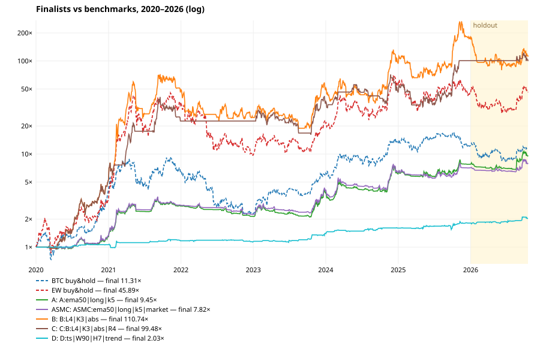
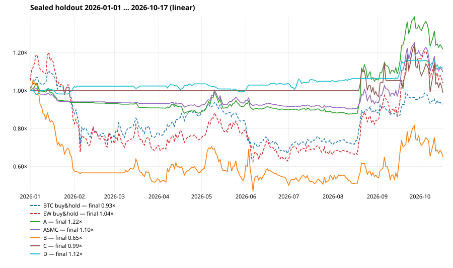

# Strategy research — portfolio-level effects (A, A+SMC, B, C, D): result

**Bottom line: no strategy passes.** Pre-registration: `docs/STRATEGY_PREREG.md` (commit 83c41ac,
written before any run, deviations D1–D5 logged before the holdout). 97 variants were run on
development (2020-01-01 … 2025-12-31, 20-coin main universe, all costs and real funding). None
reaches a deflated Sharpe ≥ 0.95. The best is 0.82 (C: momentum + BTC-trend∧vol regime). Only
that one variant survives Holm (p_holm = 0.035). The sealed holdout (2026-01-01 … 2026-10-17)
was opened once for the five frozen finalists. Trend (A) and the trend-filtered funding fade (D)
made money there and beat BTC. Momentum (B) and its regime-filtered version (C) did not. Because
no finalist met all the development criteria, there is **no live/paper-trading spec**. The nearest
candidates and what they would need are described at the end.

Reproduce: `python scripts/backtest_portfolio.py data | dev | select | holdout | report`. The
holdout refuses to re-run: the sentinel is in scratch.
Evidence: `docs/evidence/strategy-research/` contains `dev_selection.json` (all 97 variants with
every metric, the finalists, criteria, walk-forward, A+SMC−A pairs and the as-of universe),
`holdout.json`, and the SVG curves. Raw series stay in scratch (`~/.hermes/cache/scratch/strategy-research`).

## Setup (as pre-registered)

- **Engine:** `portfolio_engine.py`. A decision at the close of t fills at the open of t+1.
  Market and stop orders pay 0.05 % taker + 0.01 % slippage; limit orders pay 0.02 % maker. Stops
  fill at min(open, stop), and a same-day limit fill plus stop counts as stopped. Every perp
  position pays or receives the real Binance funding prints, with the sign taken from the
  position. Delisted contracts are closed at their last traded close.
  Benchmarks are spot-like: no funding.
- **Tests:** `tests/test_portfolio_engine.py` (14). They cover next-open fills, the funding sign
  for long and short, the midnight print, rebalancing fees, intraday, gap and same-day-limit stops,
  delisting, vol sizing and caps, and poisoned future data. Corrupting all bars and funding after
  day k leaves the equity and trades up to k bit-identical for A, B, C, D and A+SMC. An end-to-end
  check confirms the same thing: re-running the finalists on the full data reproduces the
  development Sharpe exactly.
- **Statistics:** `portfolio_stats.py`. Month-block bootstrap (2,000 resamples) for the Sharpe CI;
  month-cluster p with Holm over 97; PSR, and DSR with N = 97 and the cross-trial variance of the
  daily Sharpe; 20-seed random-entry controls at the same exposure; an expanding walk-forward over
  2022–2025.
- The ~1,600 earlier SMC/Wyckoff/CVD variants are **not** included in N = 97. Counting them would
  only lower every DSR further.

## Development 2020–2025 (main universe, net of all costs)

| strategy | CAGR | vol | Sharpe | Sharpe 95% CI | Sortino | max DD | DD days | Calmar | turnover/yr | fees/yr | funding/yr |
|---|---|---|---|---|---|---|---|---|---|---|---|
| BTC buy&hold | 51.6% | 62.0% | 0.99 | [0.19, 1.80] | 1.45 | 76.7% | 847 | 0.67 | 0.3 | 0.0% | 0.0% |
| EW buy&hold (monthly) | 87.9% | 83.5% | 1.18 | [0.34, 2.11] | 1.69 | 78.5% | 1103 | 1.12 | 2.8 | 0.2% | 0.0% |
| A `ema50 long k5` | 40.7% | 33.4% | 1.19 | [0.30, 2.05] | 1.70 | 38.5% | 823 | 1.06 | 15.6 | 0.9% | −6.0% |
| A+SMC `ema50 long k5 market` | 38.7% | 31.7% | 1.19 | [0.31, 2.03] | 1.70 | 35.6% | 822 | 1.09 | 11.5 | 0.7% | −5.6% |
| B `L4 K3 abs` | 135.2% | 86.0% | 1.42 | [0.60, 2.23] | 2.29 | 73.9% | 1150 | 1.83 | 38.7 | 2.3% | −10.1% |
| C `B L4 K3 abs + R4` | 115.5% | 62.5% | 1.54 | [0.73, 2.31] | 2.55 | 60.7% | 813 | 1.90 | 31.5 | 1.9% | −8.2% |
| D `ts W90 H7 trend` | 10.4% | 10.6% | 0.99 | [0.26, 1.68] | 1.66 | 9.5% | 150 | 1.10 | 6.8 | 0.4% | +1.4% |

Fees/yr and funding/yr are the cost drag as a share of equity (negative funding = paid).

| finalist | DSR (N=97) | p Holm | top coin (share) | random p95 Sharpe | WF stitched 2022–25 | hit / avg win / avg loss (R) | top ⅓ trades share |
|---|---|---|---|---|---|---|---|
| A | 0.51 | 0.60 | ZEC (25 %) | 1.42 > 1.19 ✗ | +71.8 % | 19 % / +1.67 / −0.15 | 184 % |
| A+SMC | 0.51 | 0.60 | ZEC (26 %) | 1.14 < 1.19 ✓ | +85.4 % | 28 % / +1.43 / −0.20 | 189 % |
| B | 0.72 | 0.13 | ZEC (47 %) | 1.34 < 1.42 ✓ | **−0.5 %** | 48 % / +4.66 / −1.58 | 297 % |
| C | 0.82 | **0.035** | ZEC (40 %) | 1.67 > 1.54 ✗ | +344.9 % | 48 % / +4.23 / −1.34 | 248 % |
| D | 0.32 | 0.59 | ZEC (38 %) | 1.04 > 0.99 ✗ | +2.2 % | 55 % / +1.99 / −1.10 | 194 % |

Pass/fail against criteria 1–6:
- Criterion 1 (DSR ≥ 0.95): failed by all five.
- Criterion 2 (Holm): only C passes.
- Criterion 3 (concentration): all pass. Even so, ZEC is the top coin for every finalist, and the
  top third of trades produces more than 100 % of net P&L, so the remainder loses money in total.
  That is typical for trend and momentum.
- Criterion 4 (Sharpe and Calmar above BTC): all pass.
- Criterion 5 (beats the random control): only A+SMC and B pass.
- Criterion 6 (walk-forward > 0): all except B pass.
- **Result: 0 / 5 finalists pass on development.**

Per-year returns are in `dev_selection.json`. A was positive in every year except 2022 (−22.6 %).
B: 2020 +409 %, 2021 +839 %, 2022 −48 %, then +97 %, +93 %, +82 %. C was flat in 2022 (in cash
the whole year).

## Sealed holdout 2026-01-01 … 2026-10-17 (opened once)

| strategy | return | Sharpe | Sharpe 95% CI | max DD | trades | top coin (share) | criterion 7 |
|---|---|---|---|---|---|---|---|
| BTC buy&hold | −7.1 % | 0.02 | [−2.03, 2.36] | 39.5 % | – | – | – |
| EW buy&hold | +3.9 % | 0.40 | [−1.46, 2.57] | 47.9 % | – | – | – |
| A `ema50 long k5` | **+21.7 %** | 0.92 | [−2.20, 2.88] | 15.7 % | 206 | NEAR (37 %) | ✓ |
| A+SMC `… market` | +9.8 % | 0.59 | [−2.08, 2.91] | 12.2 % | 142 | NEAR (91 %) | ✓ |
| B `L4 K3 abs` | **−34.9 %** | −0.35 | [−2.72, 1.58] | 55.7 % | 45 | – | ✗ |
| C `B + R4` | −1.1 % | 0.14 | [−1.33, 1.42] | 20.1 % | 16 | – | ✗ |
| D `ts W90 H7 trend` | +11.8 % | 1.29 | [−1.01, 3.40] | 4.0 % | 42 | ETH (57 %) | ✓ |

Every holdout CI spans zero. 9.5 months is too short to confirm or reject any of these on its own.

Charts (net of costs, against BTC buy-and-hold, holdout shaded):
`docs/evidence/strategy-research/equity_all.svg`, `equity_A.svg`, `equity_ASMC.svg`,
`equity_B.svg`, `equity_C.svg`, `equity_D.svg`, and `equity_holdout.svg` (holdout only, linear).

## What each idea showed

**A — time-series trend (16 variants).** Every variant is positive net of costs: development
Sharpe 0.53–1.19. The 5-ATR trail beats the 3-ATR trail in all 8 pairs. Long-only and long/short
come out about level: shorts add little after funding. Drawdowns are roughly half of BTC's
(26–45 % against 77 %). However:
- The random control matters most here. Random entries in the same coins, with the same holding
  times and weights, reach a median Sharpe of 0.81 and a 95th percentile of 1.42, against 1.19
  for the finalist.
- The A edge over random timing is therefore not significant. Most of the return is
  vol-scaled long beta to a rising market, and the trail cuts the tails.
- A was the best finalist in the holdout (+21.7 % while BTC fell 7 %).

This is the most robust family in the study, but it is not proven.

**A+SMC — SMC limit execution (32 variants, paired with A).**
- With the **market fallback**, SMC execution has no real effect: the mean ΔSharpe is −0.05 and
  it is better than A in 4/16 pairs. About 14 % of entries fill at the zone edge, saving
  ~0.3 %/yr in fees, but the skipped or worse fills cost more: ΔCAGR −4 %/yr on average.
- With **skip**, it clearly hurts: mean ΔSharpe −0.59, ΔCAGR −22 %/yr. Skip variants take only
  9–35 % as many trades as A. The signals that never pull back to an unmitigated 4h POI within
  2 days are the trends that pay.
- In the holdout A+SMC trailed A (+9.8 % against +21.7 %), and 91 % of its profit came from one
  coin.

Answer to the pre-registered question: **SMC execution does not improve trend following. It
misses trends.**

**B — cross-sectional momentum (18 variants).**
- It has the highest raw returns: the best variant made +135 % CAGR. It is the only family whose
  development Sharpe clearly beats its random-rank control (1.42 against a p95 of 1.34).
- But the gains come almost entirely from 2020–21, with drawdowns of 68–92 %.
- The walk-forward selection stitched to −0.5 % over 2022–25.
- The long/short versions are much weaker: Sharpe 0.45–0.93, because shorting the losers loses.
- In the holdout it lost 34.9 %.

**Conclusion: the momentum premium in this universe is a 2020–21 bull-market artifact plus high
beta.**

**C — regime filters (13 variants).**
- On B, the R1 filter (BTC > SMA200) and the R4 filter (R1 ∧ vol ≤ 80th percentile) raise Sharpe
  (1.42 → 1.46 / 1.54) and cut the max drawdown from 74 % to 61 %. R4 is the only variant in the
  whole study that survives Holm (p = 0.035). Its DSR is still 0.82 and it does not beat its own
  random control (p95 1.67).
- On A, all four filters lower Sharpe (1.19 → 0.73–1.12). The trail already does the filter's job.
- R3, the funding-crowding filter, hurts every base.
- On the SMC swing base (`any|idm=none|sweep=0|limit|stop=poi|r2+be`), R1 lifts the Sharpe from
  0.13 to 0.50. That is still economically negligible (CAGR +3.4 % at 0.5 % risk per trade) and
  not significant (DSR 0.05).
- Holdout for C on B: −1.1 %. The filter kept it out of the worst of B's drawdown, but it did not
  make money.

**D — funding-extreme contrarian (18 variants).**
- **The pure contrarian fade loses.** Raw time-series variants have Sharpe −0.56 to +0.11 with
  drawdowns of 37–91 %. Funding carry earned (+3 to +9 %/yr) does not cover being on the wrong
  side of crowded trends.
- Every positive time-series result comes from the **trend filter**. That filter only fades
  extremes in the EMA50 direction. In practice it mostly buys negative-funding dips in uptrends:
  86 % of the finalist's 170 trades are longs.
- The finalist (Sharpe 0.99, max DD 9.5 %, holdout +11.8 %) is effectively a pullback-in-trend
  rule. It runs at small gross exposure (6.5 % on average).
- Cross-sectional fading (short the 3 most crowded, long the 3 least) peaks at Sharpe 0.84 at
  H = 3. It turns over 167×/yr for ~10 %/yr in fees and is not significant.
- Limitation (as pre-registered): there is no long-history OI or top-trader ratio. Only funding
  and price were used.

## Survivorship check (as-of universe 2024-10-03, includes the delisted FTM, TRB, SHIB, DOT, ETC, GALA)

Development Sharpe of each finalist on the as-of list:

| finalist | Sharpe | CAGR | max DD |
|---|---|---|---|
| A | 1.13 | 39 % | 34 % |
| A+SMC | 1.13 | 37 % | 39 % |
| B | 1.28 | 111 % | 67 % |
| C | 1.40 | 101 % | 61 % |
| D | 1.17 | 11 % | 11 % |

The EW benchmark on that list: Sharpe 1.20. All finalists are slightly weaker than on the main
universe, as expected, but nothing collapses. Survivorship bias is not what drives these numbers.

## Honest conclusions

1. After costs, funding and a 97-trial deflation, **none of the four documented effects shows a
   statistically established edge** over development. The best DSR is 0.82.
2. **Trend following with vol sizing and an ATR trail** is the best risk-adjusted family:
   - drawdown about half of BTC's, and positive in the holdout;
   - but its timing does not beat random timing at the same exposure.

   It is a reasonable *risk-managed beta* overlay, not a proven alpha.
3. **SMC limit execution makes trend following worse**, even though it lowers fees.
4. **Momentum and regime-filtered momentum** had the best development numbers and lost in 2026.
   The textbook overfitting pattern of a 2020–21-driven backtest.
5. **The funding fade only works as a dip-buy inside a trend.** Against the trend it loses money.

**Nearest candidates** (not a spec — they failed the gates): A `ema50 long k5` and D
`ts W90 H7 trend`. Before anything goes live, both would need a longer out-of-sample period:
paper-track them in 2026-Q4/2027 under these exact frozen rules, then re-test with the then-unseen
data. Any new parameter search would reset the trial count.
